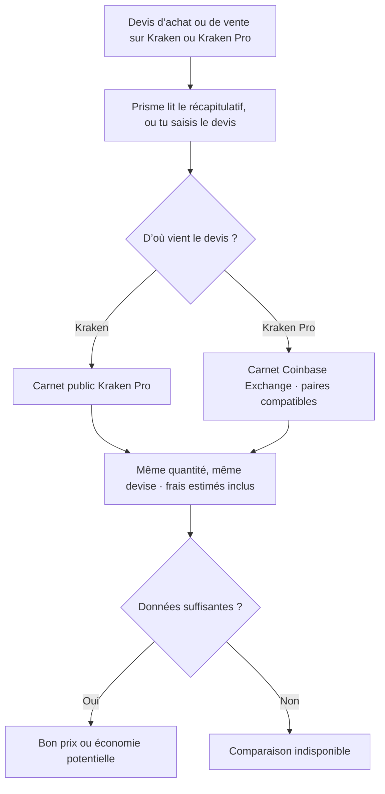

# Prisme

[English](README.en.md) · [Méthode et sources](docs/method.md) · [Propositions visuelles](docs/design.md)

Prisme est une extension Chrome qui répond à une question simple avant un achat ou une vente de crypto sur Kraken. Le total proposé est-il compétitif pour la même quantité ? Le popup affiche un verdict, l’heure de la vérification et, quand les données le permettent, l’écart après frais estimés.

## Comment ça marche ?



Coinbase Exchange sert de référence de prix pour certains devis Kraken Pro. La détection automatique est disponible sur les pages Kraken et Kraken Pro reconnues.

## Installation dans Chrome

1. Décompressez `prisme-chrome-v1.0.0.zip`. Vous pouvez aussi compiler le projet avec les commandes ci-dessous.
2. Ouvrez `chrome://extensions`, activez le **Mode développeur**, puis cliquez sur **Charger l’extension non empaquetée**.
3. Sélectionnez le dossier contenant `manifest.json`. Pour une compilation locale, sélectionnez `dist/`.
4. Ouvrez Prisme et indiquez dans **Paramètres** le taux de frais de l’ordre au marché pour la plateforme de référence. Utilisez le taux applicable à votre compte et à la paire, en pourcentage.

## Utilisation

Ouvrez Prisme sur l’aperçu d’un achat ou d’une vente au comptant. L’extension tente de lire la quantité et le total dans les récapitulatifs reconnus. Sur une page non reconnue, utilisez **Saisir un devis** pour recopier un devis affiché à l’instant. Saisissez le total à payer à l’achat ou le montant net reçu à la vente. Les frais du devis peuvent être indiqués séparément lorsqu’ils sont déjà compris dans ce total.

| Devis | Référence du calcul |
| --- | --- |
| Kraken | Ordre au marché sur Kraken Pro, à partir du carnet Spot public de Kraken |
| Kraken Pro | Ordre au marché sur Coinbase Exchange pour une sélection de paires à devises identiques |

**Bon prix** signifie que le prix proposé est au moins aussi favorable que la référence ou reste proche du total de référence après frais. Une économie éventuelle est une estimation calculée à partir du carnet, susceptible d’évoluer avant exécution. La référence indique une seule plateforme et dépend de l’accès au marché et aux fonds dans la devise affichée.

## Développement

Prérequis : Node.js 24 et pnpm 11.25.0 (`npm install --global pnpm@11.25.0`).

```sh
pnpm install --frozen-lockfile
pnpm typecheck
pnpm test
pnpm build
pnpm exec playwright install chromium
pnpm test:e2e
```

- `src/popup/` contient le popup React et ses vues.
- `src/content/` lit des récapitulatifs visibles et affiche un badge refermable, isolé par Shadow DOM.
- `src/engine/` sélectionne la paire et simule localement l’exécution dans le carnet officiel.
- `src/background.ts` valide les messages et relie le moteur au popup et au script de page.
- `.github/workflows/ci.yml` exécute TypeScript, Vitest et les parcours Chromium en CI.

## Données et périmètre

Les préférences sont stockées dans Chrome. Les devis restent en mémoire pendant le calcul et ne sont pas enregistrés. Les seules requêtes de marché sont des lectures HTTPS de catalogues et de carnets publics. Elles indiquent la paire, sans la quantité, le montant, le sens de l’ordre ni d’identifiant de compte. Prisme ne possède aucun accès de trading ou de portefeuille.

Le détecteur couvre des récapitulatifs explicites. Les variantes authentifiées de Kraken et Kraken Pro peuvent changer et n’ont pas toutes pu être vérifiées sur un compte réel. Le mode manuel couvre les devis que Prisme ne sait pas lire. Le MVP écarte les conversions crypto-crypto, les ordres à cours limité, le levier et les produits dérivés. Il ne chiffre pas les frais de financement, de transfert, de retrait ou de change nécessaires pour déplacer des fonds vers la référence. Consultez la [méthode et les limites](docs/method.md) avant d’interpréter un écart.

## Feuille de route

1. Élargir la couverture Kraken et Kraken Pro à partir de récapitulatifs anonymisés, dans plusieurs langues et mises en page.
2. Ajouter la détection côté Coinbase. Coinbase Exchange sert déjà de source publique pour certaines paires, indépendamment de la détection.
3. Ajouter Binance en validant les symboles, restrictions régionales, règles de quantité et frais de chaque marché.
4. Étudier Uniswap avec des contrôles spécifiques aux devis on-chain, au gaz et à la liquidité.

Projet indépendant de Kraken, Coinbase et Google.
