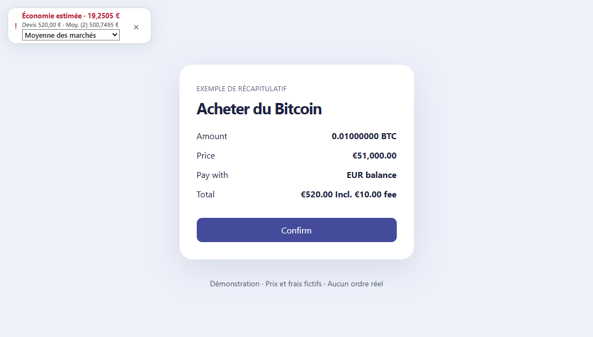
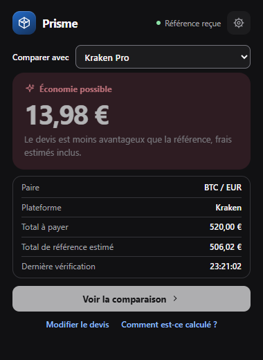
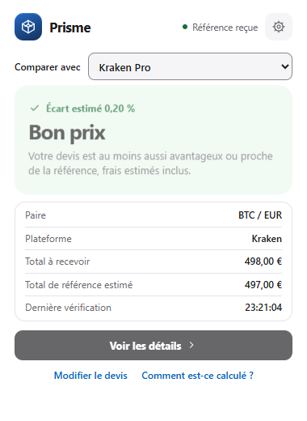
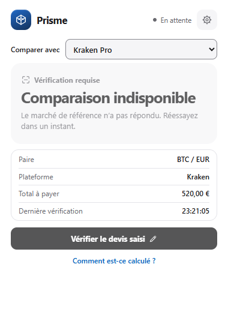
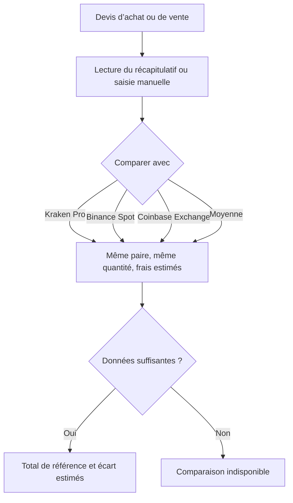

# Prisme

[English](README.en.md) · [Méthode et sources](docs/method.md) · [Propositions visuelles](docs/design.md) · [Brief produit](docs/product-brief.fr.md)

**Ton achat de crypto est-il au bon prix ?** Avant de confirmer, compare le montant que tu vas payer, frais compris, à ce que coûterait la même quantité sur Kraken Pro, Binance Spot ou Coinbase Exchange.

[**Télécharger Prisme pour Chrome**](https://github.com/nouvellealex-alt/prisme/releases/latest) · [Installation](#installation-dans-chrome)



*Exemple fictif. Pour la même quantité de BTC, le devis affiche 520 €. La moyenne estimée de deux marchés est de 500,75 €, soit 19,25 € d’écart.*

### Ce que tu vois avant de confirmer

| 🔴 Un autre marché est plus avantageux | 🟢 Le devis est compétitif | ⚪ La comparaison est indisponible |
| :---: | :---: | :---: |
|  |  |  |

*Captures de l’extension avec des données de démonstration.*

- **Compare le total.** Prisme estime le prix pour la même paire, la même quantité et la même devise, puis applique le taux de frais que tu as renseigné.
- **Choisis le point de comparaison.** Passe d’un marché à l’autre ou affiche la moyenne de deux références valides ou plus.
- **Garde ton parcours habituel.** Le badge apparaît à côté d’un récapitulatif reconnu. Tu peux aussi recopier un devis dans l’extension.

## Comment ça marche ?



## Installation dans Chrome

1. Téléchargez et décompressez le [ZIP de la dernière version](https://github.com/nouvellealex-alt/prisme/releases/latest).
2. Ouvrez `chrome://extensions`, activez le **Mode développeur** et choisissez **Charger l’extension non empaquetée**.
3. Sélectionnez le dossier contenant `manifest.json`.
4. Renseignez vos frais taker dans **Paramètres**, puis sélectionnez un marché dans **Comparer avec**.

## Utilisation

Saisissez le total à payer pour un achat ou le montant net à recevoir pour une vente. Vous pouvez indiquer séparément les frais déjà compris dans ce total.

| Source du devis | Mode |
| --- | --- |
| Kraken et Kraken Pro | Lecture automatique des récapitulatifs reconnus ou saisie manuelle |
| Tout autre site HTTPS | Détection activable par site sur les récapitulatifs reconnus, ou saisie manuelle |

Sur un autre site, ouvrez Prisme, cliquez sur **Activer sur ce site** et accordez l’accès au site affiché. La fenêtre de comparaison apparaît à côté des récapitulatifs reconnus lorsqu’elle peut s’afficher sans masquer les commandes. Vous pouvez retirer l’accès depuis les paramètres de l’extension dans Chrome.

Les références disponibles sont Kraken Pro, Binance Spot et Coinbase Exchange. La moyenne arithmétique utilise au moins deux références valides, frais compris. Vert indique un devis compétitif face à la référence choisie. Rouge indique un écart en faveur de la référence supérieur à 0,25 %. Gris indique que la comparaison est indisponible. Pour les deux références externes, le moteur limite les actifs de base à BTC, ETH et SOL. La paire exacte doit exister chez le concurrent.

**Bon prix** signifie que le prix proposé est au moins aussi favorable que la référence ou reste proche du total de référence après frais. Une économie éventuelle est une estimation calculée à partir du carnet, susceptible d’évoluer avant exécution. Les estimations supposent un accès au marché et des fonds dans la devise affichée.

## Développement

Prérequis : Node.js 24 et pnpm 11.25.0 (`npm install --global pnpm@11.25.0`).

```sh
pnpm install --frozen-lockfile
pnpm typecheck
pnpm test
pnpm build
pnpm exec playwright install chromium
pnpm test:e2e
```

- `src/popup/` contient le popup React et ses vues.
- `src/content/` lit des récapitulatifs visibles et affiche un badge refermable, isolé par Shadow DOM.
- `src/engine/` sélectionne la paire et simule localement l’exécution dans le carnet officiel.
- `src/background.ts` valide les messages et relie le moteur au popup et au script de page.
- `.github/workflows/ci.yml` exécute TypeScript, Vitest et les parcours Chromium en CI.

## Données et périmètre

Les préférences sont stockées dans Chrome. Les devis restent en mémoire pendant le calcul et ne sont pas enregistrés. Les seules requêtes de marché sont des lectures HTTPS de catalogues et de carnets publics. Elles indiquent la paire, sans la quantité, le montant, le sens de l’ordre ni d’identifiant de compte. Prisme ne possède aucun accès de trading ou de portefeuille.

Le détecteur générique reconnaît certains récapitulatifs d’achat ou de vente en français ou en anglais. Il exige des montants cohérents et explicites. Les fenêtres de signature de wallets et les récapitulatifs dans des iframes restent hors périmètre. Les variantes authentifiées de Kraken et Kraken Pro peuvent changer et n’ont pas toutes pu être vérifiées sur un compte réel. Le mode manuel couvre les devis que Prisme ne sait pas lire. Le MVP écarte les conversions entre actifs volatils, les ordres à cours limité, le levier et les produits dérivés. Il ne chiffre pas les frais de financement, de transfert, de retrait ou de change nécessaires pour déplacer des fonds vers la référence. Consultez la [méthode et les limites](docs/method.md) avant d’interpréter un écart.

## Feuille de route

1. Élargir la couverture Kraken et Kraken Pro à partir de récapitulatifs anonymisés, dans plusieurs langues et mises en page.
2. Étudier la lecture directe des récapitulatifs Binance et Coinbase.
3. Étudier Uniswap avec des contrôles spécifiques aux devis on-chain, au gaz et à la liquidité.

Projet indépendant de Kraken et Google.
