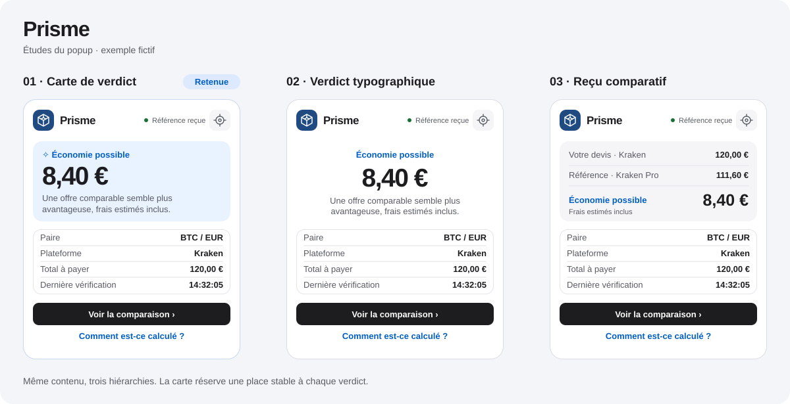

# Propositions visuelles

Les trois études utilisent les mêmes montants fictifs pour comparer leur hiérarchie visuelle. Le popup de l’extension charge uniquement des données de marché et des devis saisis ou détectés.

| Proposition | Lecture du résultat | Usage sur 380 px | Indication accessible |
| --- | --- | --- | --- |
| **01 · Carte de verdict** | Montant en tête et intitulé au-dessus | Une carte stable pour les trois états | Intitulé, icône et texte en complément de la couleur |
| **02 · Verdict typographique** | Montant centré avec peu de chrome | Le centrage donne plus de poids au chiffre et demande davantage de hauteur | Intitulé et texte centrés |
| **03 · Reçu comparatif** | Différence lue dans un mini-reçu | Les deux montants et le résultat partagent l’espace | Libellés distincts pour le devis et la référence |

**Choix retenu · Carte de verdict.** Un bloc fixe porte le verdict et son explication, les quatre éléments de contexte suivent dans le même ordre et la comparaison détaillée reste à un clic. La même structure accueille un chiffre, « Bon prix » ou « Comparaison indisponible ». Le fond évolue selon l’état, avec une indication textuelle et une icône.

Le popup utilise des polices système, les couleurs du système par défaut, des cibles clavier visibles et des transitions de 180 ms. L’option de réduction des animations du système désactive les mouvements.
